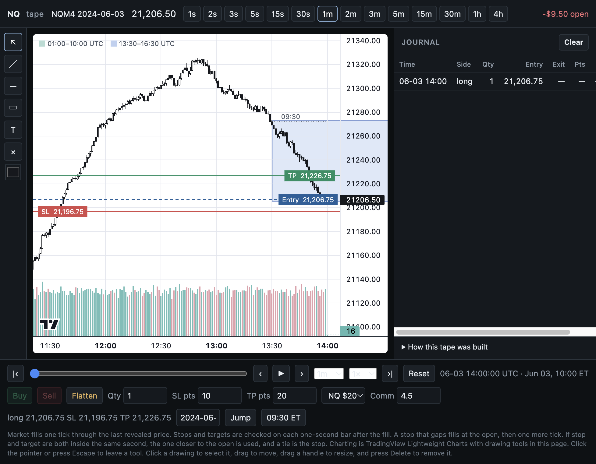

# NQ tape

Replay Nasdaq-100 futures one second at a time. The page keeps a front-month tape, draws on it, and papers a ticket against the seconds you have revealed.



The chart above is the sample that ships with the repo, a seeded walk so the page opens before you add a file. It is not a market recording.

## Run

Python 3.11 or newer.

```bash
python3 -m venv .venv
source .venv/bin/activate
pip install -r requirements.txt
python data.py
```

Open [http://127.0.0.1:8780](http://127.0.0.1:8780). The chart library is [TradingView Lightweight Charts](https://www.tradingview.com/lightweight-charts/) 4.2.3, loaded from unpkg, so the browser needs a network connection.

`databento` is only used when you build a tape. The sample runs on numpy and pandas.

## Bring your own data

One Databento GLBX.MDP3 file, schema `ohlcv-1s`, dropped in `data/` as a `.dbn.zst`. The builder keeps NQ quarterly outrights (`NQH`, `NQM`, `NQU`, `NQZ` with a year code). Then:

```bash
python data.py --rebuild
```

That writes three files and serves them:

| File | What it is |
|---|---|
| `data/front_1s.bin` | Packed one-second bars, little-endian |
| `data/front_meta.json` | Tick, point value, sessions, and the build notes |
| `data/roll_schedule.csv` | Which outright was the front, session by session |

A bar is kept when the symbol is an outright, the four prices sit on a 0.25 tick and between 5,000 and 80,000, the one-second range is at most 80 points, and the second is not the 17:00–18:00 ET halt or the Friday 17:00 to Sunday 18:00 ET close. A second that jumps more than 60 points, or 0.4%, from the previous print of that same contract is dropped.

The tape is one outright at a time and the prices are not back-adjusted. The roll sticks: after the first finished Globex session in which the next quarter trades more than the current one, the following session uses the next quarter and does not flip back. Sunday 18:00 ET belongs to Monday's session.

### Binary layout

Each record in `front_1s.bin` is 24 bytes, little-endian, in time order.

| Field | Type | Meaning |
|---|---|---|
| `ts` | int64 | Unix seconds, UTC |
| `o`, `h`, `l`, `c` | int32 | Price in ticks. Multiply by `tick` (0.25) |
| `v` | uint32 | Volume for that second |

`front_meta.json` carries `tick`, `point_value` (20), `rows`, and a `days` array. Each day has `date`, `symbol`, `start_ts`, `end_ts`, `roll`, `open`, and `rth_ts` (the 09:30 ET print, when that session has one).

`data/sample/` is the same pair of files, generated by `scripts/make_sample.py`.

## On the page

Timeframes from 1s to 4h are aggregated from the one-second tape, so a higher timeframe never shows a second you have not reached.

| Key | Action |
|---|---|
| Space | Play or pause |
| Left / right | One candle |
| B | Buy |
| S | Sell |
| F | Flatten |
| Escape | Leave the drawing tool |
| Delete | Remove the selected drawing |
| Cmd-Z or Ctrl-Z | Undo a drawing |

The jump box takes a UTC time, `2024-06-03 14:00 UTC`. **09:30 ET** moves to the next cash open.

A buy or sell fills one tick through the last revealed price. The stop and the target are checked on each one-second bar after the fill. A stop that gaps fills at the open, then one more tick. When the stop and the target both sit inside the same second, the one closer to that second's open is used, and a tie is the stop. NQ is $20 a point and MNQ is $2. Commission starts at $4.50 a round turn.

Drawings are a trend line, a horizontal line, a rectangle, and text. Click a drawing to select it, drag it to move, drag a handle to resize. The mint band is 01:00–10:00 UTC and the blue band is 13:30–16:30 UTC.

The journal and the drawings are written to `journal.json` and `drawings.json` beside the app. They stay on your machine.

## License

MIT. See [LICENSE](LICENSE). Lightweight Charts is Apache-2.0, from TradingView. The sample walk is not market data, and a Databento file you add is not part of this repo.
